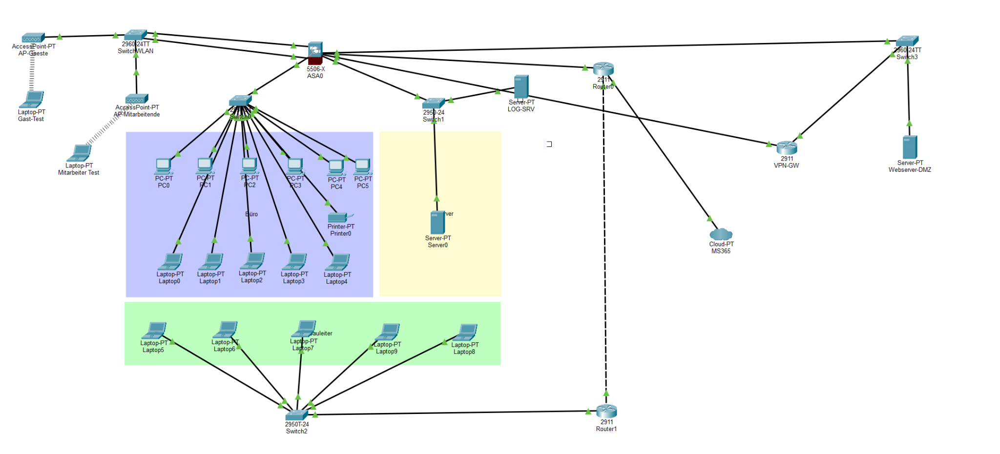
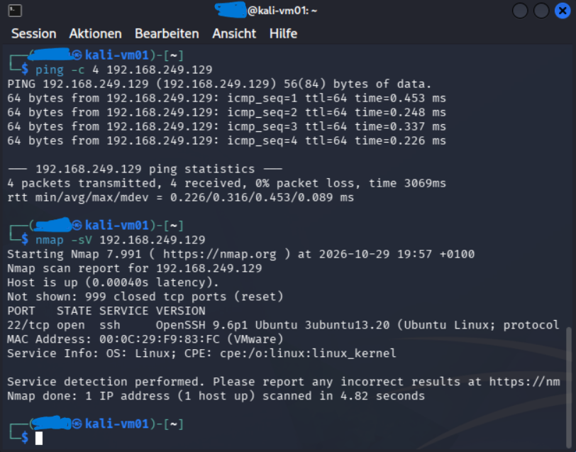
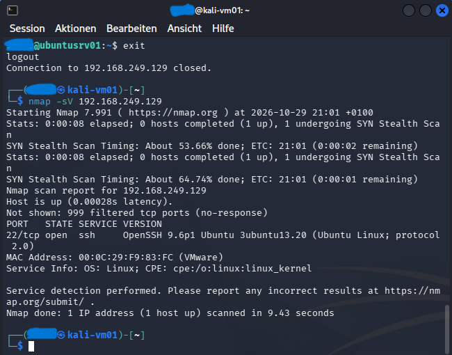
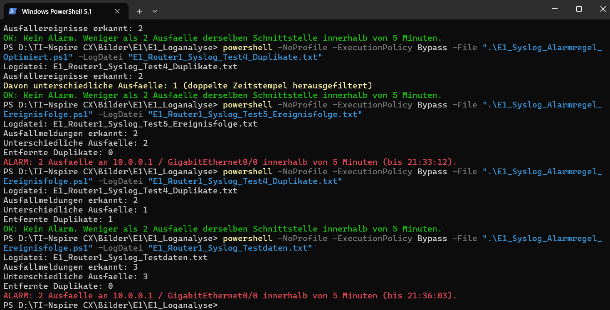
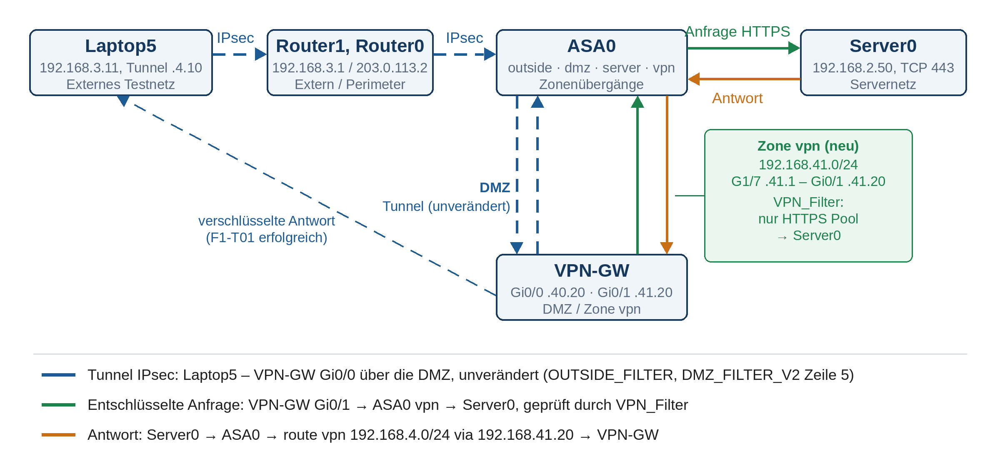
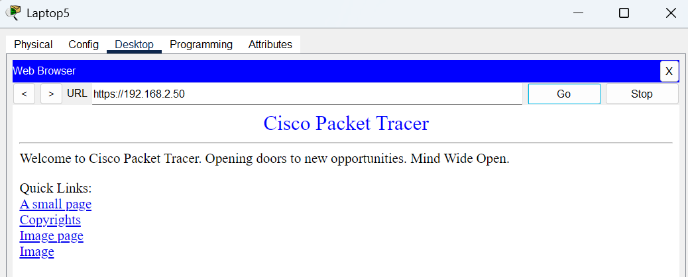

# BauWert – Network Security Lab

**Network Security | Cisco Packet Tracer | Kali Linux | Debian | Ubuntu | Python | PowerShell**

**Final Grade: 6.0 / 6.0 – Highest Swiss Grade**

A hands-on cybersecurity project focused on securing the network infrastructure of a fictional construction company against ransomware, unauthorized access, data exfiltration, and lateral movement.

Developed as a two-person team project during the Swiss vocational training programme in Information Technology (EFZ), specializing in Platform Development.

The project combines network security design, practical system hardening, security testing, automated monitoring, and structured troubleshooting.

## Network Architecture



The simulated infrastructure includes Cisco routers and switches, a Cisco ASA firewall, internal servers, a DMZ, wireless networks, a VPN gateway, and a centralized logging server.

The architecture follows the principles of **network segmentation, least privilege, access control, and defence in depth**.

## Project Overview

The project was based on a simulated ransomware scenario called **Blackout**.

The attack scenario involved compromised Microsoft 365 credentials, unauthorized network access, lateral movement, data exfiltration, and the encryption of business-critical systems.

Our objectives were to:

- Analyse the existing network infrastructure.
- Identify vulnerabilities and evaluate security risks.
- Design a secure and segmented network architecture.
- Configure firewalls, access controls, and remote access.
- Harden Linux and Windows systems.
- Perform security tests and validate configurations.
- Implement centralized logging and automated monitoring.
- Troubleshoot network connectivity and VPN issues.

## Technologies & Tools

| Technology | Application |
|---|---|
| Cisco Packet Tracer | Network simulation and security testing |
| Cisco ASA Firewall | Firewall configuration and access control |
| Cisco ISR Routers | Routing and VPN configuration |
| VLANs & DMZ | Network segmentation and service isolation |
| IPsec VPN | Secure remote access |
| Access Control Lists | Traffic filtering and access restrictions |
| Kali Linux | Security assessment and network reconnaissance |
| Nmap | Port scanning and firewall validation |
| Ubuntu Server | Linux system hardening and security testing |
| Debian 13 | Centralized Syslog reception and monitoring |
| Windows | Endpoint security and account policies |
| Python | Syslog collection and automated alert detection |
| PowerShell | Offline security log analysis |
| VMware Workstation | Virtualized laboratory environments |

## Project Implementation

The project covered nine competency areas, from A1 to F1.

| Competency | Focus |
|---|---|
| A1 | Existing infrastructure analysis |
| A2 | Vulnerability identification and risk assessment |
| B1 | Secure network architecture and segmentation |
| B2 | VPN, remote access and intrusion detection concepts |
| C1 | Firewall and security component configuration |
| C2 | Linux and Windows system hardening |
| D1 | Security testing and validation |
| E1 | Monitoring, Syslog analysis and alert detection |
| F1 | Troubleshooting and fault resolution |

## Network Security Controls

We designed and examined a segmented network architecture to reduce unauthorized access and limit potential attack propagation.

The security concept included:

- Separation of office, server, guest and employee networks.
- DMZ protection for externally accessible services.
- Firewall rules restricting unnecessary communication.
- VPN connectivity for remote users.
- Access Control Lists following least-privilege principles.
- Monitoring of security-relevant network events.

### Firewall and DMZ Testing

Security tests were performed to examine permitted and restricted network communication.

The documented tests included successful HTTPS access to a DMZ web server and restrictions on HTTP connections.

Firewall configuration, routing information and packet-flow evidence were used to evaluate the observed results.

Detailed documentation:

[Network Security Controls](network-security-controls/)

## Network Security Testing – Kali Linux & Nmap

### Nmap Security Assessment – Before & After UFW

The following screenshots document the network exposure of an Ubuntu Server before and after UFW firewall hardening.

**Before – Initial Nmap Scan**



The initial scan identified an open SSH service on TCP port 22 and 999 closed TCP ports.

**After – Firewall Hardening**



After applying UFW restrictions, SSH remained accessible while the other 999 scanned TCP ports were reported as filtered.

**Key Result:** The test demonstrates how firewall configuration changes the network responses visible during reconnaissance.


In addition to Cisco Packet Tracer, we established VMware-based Linux laboratory environments.

Kali Linux and Nmap were used to assess network accessibility and investigate the effectiveness of firewall restrictions on an Ubuntu Server.

### Initial Assessment

Nmap scans were performed to identify reachable network services and examine open, closed and filtered ports.

### Firewall Configuration

Ubuntu's Uncomplicated Firewall (UFW) was used to restrict unnecessary network communication while retaining authorized SSH access.

### Verification

Additional Nmap scans were performed after applying firewall restrictions.

Comparing the results demonstrated the effect of the firewall configuration on network exposure.

The tests helped us understand the differences between open, closed and filtered ports and the importance of validating security controls through practical measurements.

Detailed documentation:

[Security Testing with Kali Linux & Nmap](security-testing/)

## System Hardening – Linux & Windows

System hardening was performed and evaluated in dedicated virtualized test environments.

### Ubuntu Server Hardening

We examined and applied security measures including:

- Restricted SSH root login.
- Reduced SSH authentication attempts.
- Disabled unnecessary SSH features.
- UFW firewall configuration.
- Automatic security updates.
- AppArmor security profiles.
- Verification of effective system configurations.

Example SSH configuration:

```text
PermitRootLogin no
MaxAuthTries 3
X11Forwarding no
```

The configuration was reviewed using commands such as `sshd -T`, `ufw status`, and `aa-status`.

### Windows Security

We reviewed Windows endpoint and account protection mechanisms, including:

- Microsoft Defender Antivirus
- Windows Firewall
- Controlled Folder Access
- Microsoft Defender SmartScreen
- Windows Update
- Local account policies
- Administrator permissions

The `net accounts` command was used to examine local account policies.

The work was informed by established security guidance, including BSI IT-Grundschutz, CIS Benchmarks and Microsoft Security Baselines.

Detailed documentation:

[Linux & Windows System Hardening](system-hardening/)

## Security Monitoring & Automation

We developed Python and PowerShell scripts to support centralized logging, automated event analysis and network monitoring.

### Debian 13 – Centralized Syslog Monitoring

A Debian-based laboratory environment was used to receive and process Syslog messages.

The Python implementation includes:

- UDP-based Syslog reception.
- Local storage of incoming messages.
- Detection of network interface status changes.
- Identification of repeated interface failures.
- Automated generation of alerts.

The Syslog receiver uses UDP port `5514` in the original laboratory configuration.

### PowerShell – Event Analysis

PowerShell scripts were developed to analyse exported Syslog messages from Cisco Packet Tracer.

The analysis evaluates repeated interface failures, chronological event sequences and duplicate messages.

An alert can be generated when two distinct failures of the same interface occur within five minutes.

### Monitoring Test Evidence



The screenshot documents the original monitoring tests, including successful alarm detection and handling of duplicate events.

Source code, sample data and setup instructions:

[Security Monitoring & Syslog Analysis](monitoring/)

## VPN Troubleshooting – Root Cause Analysis

One of the most technically challenging parts of the project involved troubleshooting an IPsec VPN connection.

### Problem

During the original project tests, the VPN tunnel was established successfully, but the remote client could not access the internal server (Server0) over HTTPS.

### Investigation

We analysed the connection using:

- Firewall ACL hit counters.
- IPsec encryption and decryption counters.
- Routing tables.
- ARP behaviour.
- Cisco Packet Tracer simulation mode.
- End-to-end packet-flow analysis.

### Root Cause and Resolution

The investigation identified a problem involving the return path of VPN traffic and the ASA firewall's ARP behaviour.

A dedicated VPN network zone was introduced to correct the packet path without unnecessarily relaxing the existing firewall security rules.

### Packet Flow Analysis



### Original HTTPS Test Evidence



The screenshot documents successful HTTPS connectivity during the original project work.

**Verification Note:** A subsequent attempt to reproduce the VPN connection using the archived Packet Tracer file timed out during ISAKMP negotiation. The original evidence is therefore presented as a historical project result rather than a newly reproduced successful test.

## Project Results

The project combined theoretical cybersecurity concepts with practical implementation, testing and technical troubleshooting.

### Security Controls & Validation Summary

| Security Area | Implementation & Verification | Result |
|---|---|---|
| Network Segmentation | VLANs, security zones and restricted network communication | Tested in original project |
| Firewall & DMZ | HTTPS access permitted and HTTP access restricted in documented tests | Tested in original project |
| Kali Linux & Nmap | Port scanning before and after UFW configuration | Tested |
| Ubuntu Hardening | SSH configuration, UFW rules, updates and AppArmor | Configured and reviewed |
| Windows Security | Defender, firewall, account policies and ransomware protection | Reviewed and documented |
| Syslog Monitoring | Python and PowerShell analysis of repeated interface failures | Tested |
| IPsec VPN | VPN connectivity and HTTPS access to Server0 | Original test successful; archived retest failed |
| MFA & IPS | Security concepts and implementation recommendations | Conceptual only |

### Technical Documentation

Detailed documentation and selected evidence are available in the following directories:

- [Network Security Controls](network-security-controls/)
- [Security Testing with Kali Linux & Nmap](security-testing/)
- [Linux & Windows System Hardening](system-hardening/)
- [Syslog Monitoring & Automation](monitoring/)
- [Network Topology & VPN Evidence](topology/)

**Verification Note:** Results refer to the original educational project. Not all tests were successfully reproduced using the archived Cisco Packet Tracer configuration.

## Key Learning Outcomes

This project strengthened our practical knowledge in:

- Network infrastructure analysis and risk assessment.
- Secure network architecture and segmentation.
- Cisco routing, firewalls and VPN technologies.
- Linux administration and system hardening.
- Windows endpoint security.
- Network security testing with Kali Linux and Nmap.
- Python-based monitoring and automation.
- PowerShell scripting and security event analysis.
- Network troubleshooting and root cause analysis.
- Technical documentation and team collaboration.

One of the most important lessons was learning to investigate technical problems using measurable evidence rather than relying on assumptions.

The project also demonstrated that network security requires multiple coordinated security controls instead of relying on a single protection mechanism.

## Project Information

| Category | Details |
|---|---|
| Project | BauWert – Network Security Lab |
| Module | ÜK 184 – Implementing Network Security |
| Training | Swiss Federal VET Diploma (EFZ), Platform Development |
| Team | Two students |
| Completion | November 2026 |
| Status | Completed |
| Final Grade | **6.0 / 6.0 – Highest Swiss Grade** |

## Limitations & Disclaimer

This repository documents a fictional business environment developed for educational purposes.

All security testing was carried out in controlled laboratory or simulated network environments.

Some security measures, including MFA and selected IPS capabilities, could not be fully implemented within Cisco Packet Tracer and were therefore documented conceptually.

The scripts and network configurations are educational prototypes and should not be considered production-ready without further security review, testing and adaptation.

The original Packet Tracer project file is not included because the archived VPN configuration could not be successfully revalidated.
