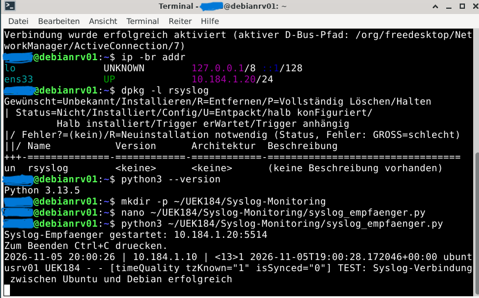
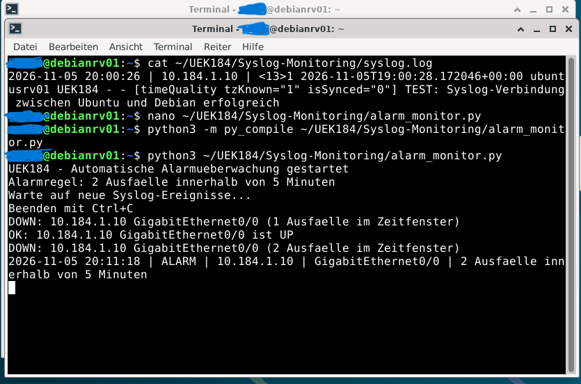
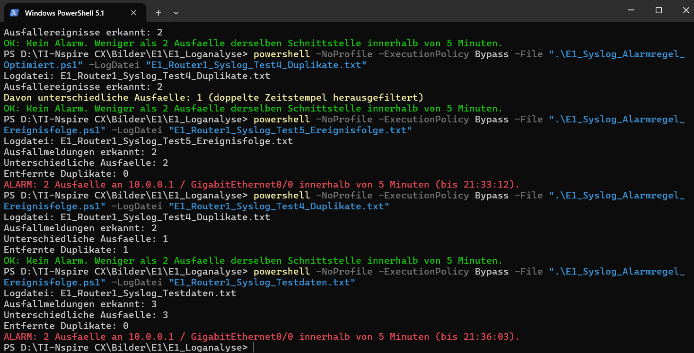

# Security Monitoring & Syslog Analysis

**Python | PowerShell | Debian 13 | Cisco Packet Tracer | Network Security**

## Project Overview

This directory contains the security monitoring scripts, test data, and technical evidence developed for the BauWert Network Security Lab (ÜK 184).

The objective was to collect Syslog messages, analyse network events, detect repeated interface failures, and generate automated alerts.

Two complementary monitoring approaches were implemented:

- **Python on Debian 13:** UDP Syslog collection and automated monitoring of network interface events.
- **PowerShell on Windows:** Offline analysis of exported Cisco Packet Tracer Syslog messages.

The implementation was developed and tested in a controlled educational laboratory environment.

## Technologies & Tools

| Technology | Purpose |
|---|---|
| Debian 13 | Centralized Syslog receiver |
| Python 3 | Syslog collection and automated alert detection |
| PowerShell 5.1 | Offline log analysis |
| Cisco Packet Tracer | Simulation of network events |
| UDP Port 5514 | Syslog message reception |
| VMware Workstation | Virtualized Linux environment |

## Project Files

| File | Description |
|---|---|
| `syslog_empfaenger.py` | UDP Syslog receiver |
| `alarm_monitor.py` | Automated interface failure monitoring |
| `E1_Syslog_Alarmregel_Ereignisfolge (1).ps1` | PowerShell event sequence analysis |
| `E1_Router1_Syslog_Test5_Ereignisfolge.txt` | Sample Syslog events |
| `monitoring-alert-detected.png` | PowerShell monitoring test evidence |
| `debian-syslog-receiver.png` | Debian Syslog receiver screenshot |
| `debian-automated-alert.png` | Debian automated monitoring screenshot |

## 1. Debian 13 – Centralized Syslog Receiver

A Debian-based laboratory environment was configured to receive and store Syslog messages.

The Python application uses a UDP socket to listen for incoming messages and records their timestamps, sender IP addresses, and message contents.

### Original Laboratory Configuration

| Parameter | Value |
|---|---|
| Server | Debian 13 |
| Listening IP | `10.184.1.20` |
| Protocol | UDP |
| Port | `5514` |
| Log file | `~/UEK184/Syslog-Monitoring/syslog.log` |

### Setup

Create the required directory:

`mkdir -p ~/UEK184/Syslog-Monitoring`

Create the Syslog file:

`touch ~/UEK184/Syslog-Monitoring/syslog.log`

Start the receiver from the directory containing the script:

`python3 syslog_empfaenger.py`

The receiver displays incoming messages and stores them in the log file.

**Note:** The configured IP address must exist on the host. For a different laboratory environment, update the `HOST` variable in the Python script.

### Debian – Syslog Receiver Evidence

The following screenshot documents the Syslog receiver in the original Debian laboratory environment.

## 2. Python – Automated Alert Monitoring

The second Python script, `alarm_monitor.py`, monitors newly appended Syslog messages.

It identifies network interface status changes and detects repeated failures.

### Alert Detection

The monitoring logic evaluates the following conditions:

- Two interface failures within five minutes.
- The same source IP address and network interface.
- An intervening UP event distinguishes separate failures.
- Repeated DOWN messages without an intervening UP event are ignored as duplicates.

The detection window is configured to 300 seconds.

When the alert condition is met, a message is displayed and written to:

`~/UEK184/Syslog-Monitoring/alarme.log`

### Running the Monitor

Start the Syslog receiver first.

Open a second terminal and execute:

`python3 alarm_monitor.py`

The script monitors newly received events. Previously stored log entries are skipped when monitoring starts.

### Debian – Automated Alert Evidence

The following screenshot documents the automated monitoring implementation in the Debian test environment.

## 3. PowerShell – Offline Syslog Analysis

A separate PowerShell script was developed to analyse exported Syslog messages from Cisco Packet Tracer.

Unlike the Python implementation, this solution does not provide live monitoring. It processes previously recorded event data.

### Analysis Features

The script evaluates:

- Network interface DOWN and UP events.
- Repeated interface failures within a configurable time window.
- Event sequences sharing identical timestamps.
- Duplicate DOWN messages.
- Interface-specific alarm conditions.

To preserve the correct event sequence, events are evaluated using both their timestamps and their original line positions.

### Running the PowerShell Script

Open PowerShell in the `monitoring` directory.

Example command:

`& '.\E1_Syslog_Alarmregel_Ereignisfolge (1).ps1' -LogDatei 'E1_Router1_Syslog_Test5_Ereignisfolge.txt'`

The script displays the number of detected failure messages, distinct failures, removed duplicates, and the resulting alarm status.

PowerShell script execution must be permitted by the applicable local execution policy.

## 4. PowerShell – Test Results

The original project included tests using different Syslog event sequences.

### Test Scenario: Repeated Interface Failure

1. The monitored interface changes to DOWN.
2. The interface returns to UP.
3. The same interface changes to DOWN again.
4. Both distinct failures occur within five minutes.

**Expected result:** An alarm is generated for the repeated interface failure.

### Duplicate Event Handling

Repeated DOWN messages with the same timestamp and no intervening UP event are treated as duplicates.

This prevents such duplicate entries from being counted as independent failures.

### PowerShell Monitoring Evidence

The screenshot documents the original PowerShell test results, including alarm detection and duplicate-event handling.

## 5. Security Benefits

The monitoring implementation demonstrates several important principles of network security:

- Centralized collection of network events.
- Automated detection of repeated interface failures.
- Improved visibility into network availability.
- Correlation of related Syslog messages.
- Reduction of duplicate-triggered alerts.
- Structured analysis of security-relevant events.

These mechanisms support the identification and investigation of unusual network behaviour.

However, repeated interface failures alone do not prove that a cybersecurity attack has occurred.

## 6. Technical Limitations

The monitoring solution was developed for educational purposes and has several limitations:

- The Python receiver uses a fixed laboratory IP address.
- UDP does not guarantee message delivery.
- The scripts depend on the expected Syslog message format.
- The Python scripts require the configured log directory to exist.
- The PowerShell implementation processes exported files rather than live events.
- The scripts have not been validated as production-ready monitoring solutions.

A production implementation would require additional security controls, testing, error handling, and operational monitoring.

## 7. Key Learning Outcomes

This part of the project strengthened our practical knowledge of:

- Debian Linux administration.
- Python socket programming.
- Centralized Syslog collection.
- Automated event detection.
- PowerShell scripting.
- Log analysis and event correlation.
- Duplicate detection.
- Network monitoring and troubleshooting.

The main lesson was understanding how network events can be collected, analysed, and converted into actionable alerts through simple automation mechanisms.

---

## Project Information

**Project:** BauWert – Network Security Lab

**Module:** ÜK 184 – Implementing Network Security

**Environment:** Debian 13, Windows PowerShell, Cisco Packet Tracer

**Status:** Completed – November 2026

**Final Grade:** 6.0 / 6.0 (Highest Swiss Grade)

**Disclaimer:** All configurations, scripts, and tests were created for controlled educational laboratory use and are not intended for production deployment without further review.
