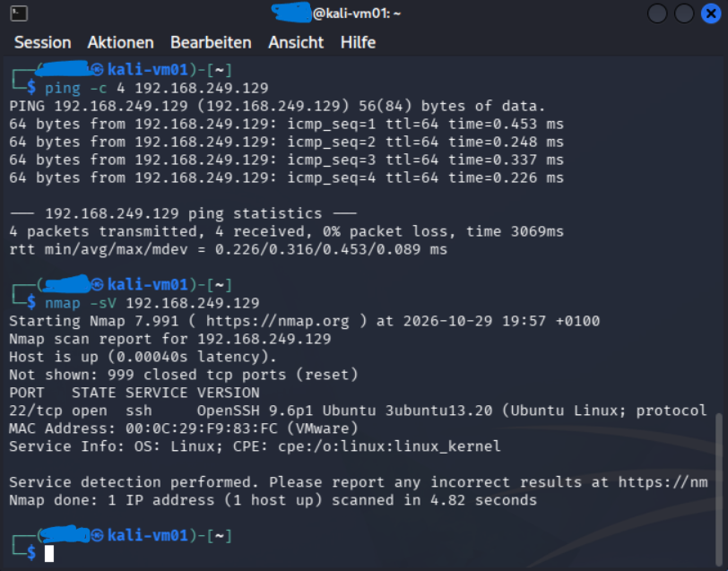
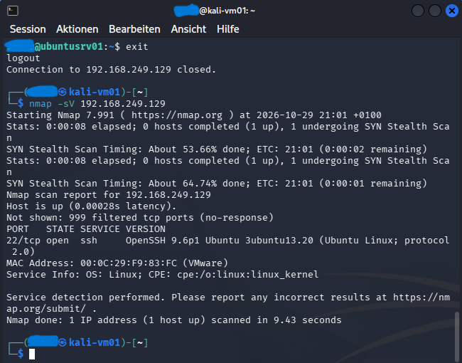

# Network Security Testing – Kali Linux & Nmap

## Overview

This section documents network security testing performed in a controlled VMware laboratory environment as part of the BauWert Network Security Lab.

Kali Linux and Nmap were used to examine the network exposure of an Ubuntu Server and verify the effects of UFW firewall configuration.

## Test Environment

| Component | Purpose |
|---|---|
| Kali Linux | Security testing workstation |
| Nmap | Network and service scanning |
| Ubuntu Server | Target system |
| UFW | Host-based firewall |
| VMware Workstation | Virtualized laboratory environment |

## 1. Initial Network Assessment

Before enabling the firewall restrictions, an Nmap service scan was performed against the Ubuntu Server.

Command used:

`nmap -sV 192.168.249.129`

### Initial Scan Results

- Target host was reachable.
- TCP port 22 (SSH) was open.
- OpenSSH 9.6p1 was detected.
- 999 TCP ports were reported as closed.

### Evidence – Before Firewall Configuration

## 2. Firewall Hardening

Ubuntu's Uncomplicated Firewall (UFW) was used to restrict unnecessary incoming network traffic.

SSH connectivity was retained for administration.

The objective was to reduce network exposure without preventing authorized remote access.

## 3. Verification After Firewall Configuration

The Nmap scan was repeated after applying the UFW restrictions.

Command used:

`nmap -sV 192.168.249.129`

### Updated Scan Results

- Target host remained reachable.
- TCP port 22 (SSH) remained open.
- 999 TCP ports were reported as filtered.
- The other scanned ports no longer returned the same closed-port responses as before.

### Evidence – After Firewall Configuration

## 4. Before and After Comparison

| Test | Before UFW | After UFW |
|---|---|---|
| Host reachable | Yes | Yes |
| SSH (TCP 22) | Open | Open |
| Other 999 scanned TCP ports | Closed | Filtered |
| Administrative SSH access | Available | Available |

The results demonstrate a change in the network responses observed by Nmap after the firewall configuration.

A filtered port does not respond in the same way as a closed port, which can reduce information exposed during network reconnaissance.

## 5. Key Learning Outcomes

- Network reconnaissance using Kali Linux and Nmap
- Service detection using `nmap -sV`
- Understanding open, closed and filtered TCP ports
- Configuring host-based firewall restrictions
- Maintaining SSH access during firewall hardening
- Validating configuration changes through repeated testing

## Limitations

The scan covered Nmap's default selection of 1,000 TCP ports rather than every possible port.

The tests were performed in an isolated educational VMware environment. The results do not constitute a complete vulnerability assessment or penetration test.

---

**Project:** BauWert – Network Security Lab

**Module:** ÜK 184 – Implementing Network Security

**Final Grade:** 6.0 / 6.0
