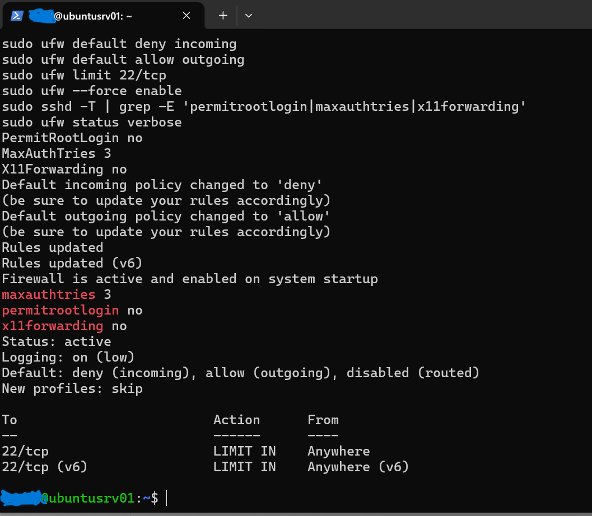
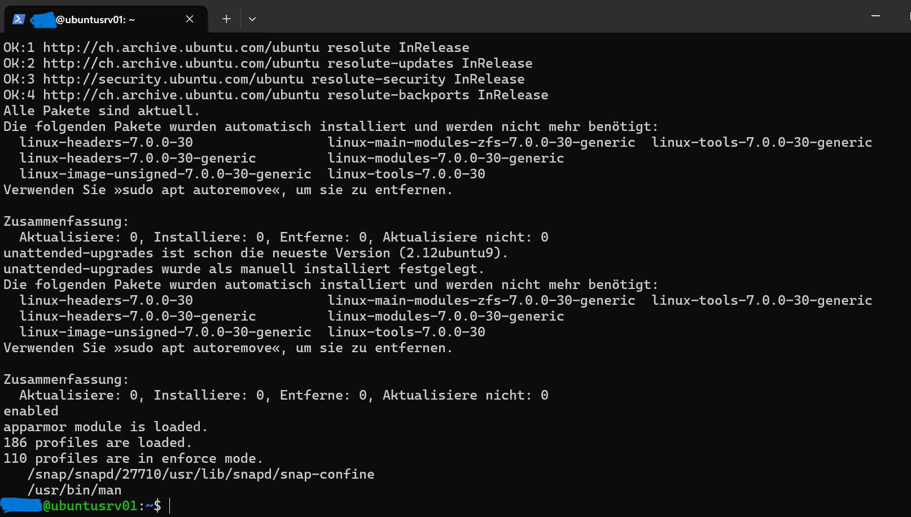
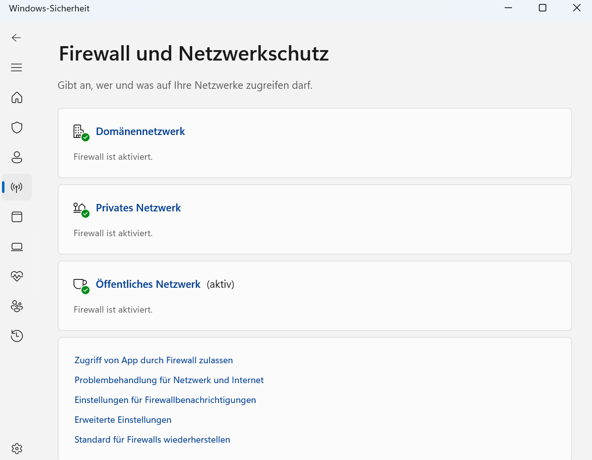

# Linux & Windows System Hardening

**Ubuntu Server | Windows Security | SSH | UFW | AppArmor | Security Updates**

## Project Overview

This directory documents the operating system hardening measures implemented and reviewed during the BauWert Network Security Lab (ÜK 184).

The objective was to reduce unnecessary attack surfaces, restrict unauthorized access, and improve the security posture of Linux and Windows systems.

The activities were performed in controlled laboratory environments.

## Technologies & Security Controls

| Component | Security Focus |
|---|---|
| Ubuntu Server | Linux system hardening |
| OpenSSH | Secure remote administration |
| UFW | Host-based firewall |
| AppArmor | Application access control |
| APT | Package and security updates |
| unattended-upgrades | Automatic update mechanism |
| Windows Security | Endpoint protection |
| Microsoft Defender Firewall | Network traffic protection |
| Windows Account Policies | User and authentication security |

## 1. Ubuntu Server – SSH Hardening

SSH configuration was reviewed to reduce risks associated with remote administration.

The effective configuration included:

| Setting | Verified Value | Security Purpose |
|---|---|---|
| PermitRootLogin | no | Prevent direct SSH login as root |
| MaxAuthTries | 3 | Limit authentication attempts per connection |
| X11Forwarding | no | Disable unnecessary X11 forwarding |

The effective SSH settings were checked using `sshd -T`.

These measures help restrict remote access and reduce unnecessary SSH functionality.

## 2. Ubuntu Server – UFW Firewall

UFW was configured to control incoming and outgoing network traffic.

The documented configuration included:

- Deny incoming connections by default.
- Allow outgoing connections by default.
- Apply rate limiting to incoming SSH connections on TCP port 22.
- Enable the firewall.
- Enable firewall logging.

### Firewall Verification

The `ufw status verbose` output confirmed:

- Firewall status: active
- Incoming policy: deny
- Outgoing policy: allow
- SSH port 22: LIMIT IN
- IPv4 and IPv6 SSH rules present

### SSH & UFW Evidence

The screenshot shows the effective SSH settings and active UFW firewall rules from the original laboratory tests.

## 3. Ubuntu Server – Security Updates

Package updates and the availability of the `unattended-upgrades` package were reviewed.

The documented terminal output showed that the package lists were updated and no additional package upgrades were pending at the time of verification.

The `unattended-upgrades` package was already installed.

This check documents the package state; it does not independently demonstrate that an automatic update was successfully executed.

## 4. Ubuntu Server – AppArmor

AppArmor was used to examine application-level security restrictions.

The original verification confirmed:

- AppArmor kernel module loaded.
- 186 security profiles loaded.
- 110 profiles in enforce mode.

These results show that AppArmor was active and enforcing restrictions for a subset of the loaded profiles.

### Updates & AppArmor Evidence

The screenshot documents the package update checks and AppArmor status.

## 5. Windows – Endpoint Security

Windows security settings were reviewed as part of the system hardening activities.

The review covered:

- Microsoft Defender Antivirus.
- Microsoft Defender Firewall.
- Microsoft Defender SmartScreen.
- Controlled Folder Access.
- Windows Update.
- Local account security policies.
- Administrative permissions.

These controls contribute to malware protection, network isolation, account security, and ransomware risk reduction.

### Windows Firewall Verification

The original screenshot confirms that Microsoft Defender Firewall was enabled for all three network profiles:

| Network Profile | Firewall Status |
|---|---|
| Domain network | Enabled |
| Private network | Enabled |
| Public network | Enabled |

The public network profile was the active profile at the time of the screenshot.

### Windows Firewall Evidence

This screenshot demonstrates the Windows Firewall status in the original test environment.

## 6. Security Verification Summary

| Security Control | Verification Method | Documented Result |
|---|---|---|
| SSH root login | Effective SSH configuration | Disabled |
| SSH authentication attempts | Effective SSH configuration | Limited to 3 |
| SSH X11 forwarding | Effective SSH configuration | Disabled |
| UFW firewall | Firewall status and rules | Active |
| SSH firewall restriction | UFW rule inspection | Rate limiting enabled |
| Ubuntu updates | APT package check | No pending upgrades shown |
| AppArmor | Security profile status | Active, profiles enforced |
| Windows Firewall | Windows Security interface | Enabled for all network profiles |

## 7. Security Benefits

The hardening activities demonstrate the importance of applying multiple layers of protection:

- Restricting unnecessary remote access.
- Filtering incoming network traffic.
- Maintaining operating system packages.
- Applying application-level restrictions.
- Enabling endpoint firewall protection.
- Reviewing account and authentication security.

Together, these controls contribute to a defence-in-depth security strategy.

## 8. Limitations

The work was conducted in educational laboratory environments.

The screenshots document specific configuration checks at the time of testing. They do not constitute a complete security audit.

Not every Windows security feature discussed in the project is independently demonstrated by the three screenshots in this directory.

Additional validation would be necessary before applying these configurations in a production environment.

## Key Learning Outcomes

- Linux system administration and hardening.
- Secure SSH configuration.
- UFW firewall configuration and verification.
- Linux package maintenance.
- AppArmor security enforcement.
- Windows endpoint protection.
- Security configuration validation.
- Technical evidence documentation.

---

**Project:** BauWert – Network Security Lab

**Module:** ÜK 184 – Implementing Network Security

**Final Grade:** 6.0 / 6.0 – Highest Swiss Grade

**Disclaimer:** All configurations and tests were developed for educational purposes in controlled laboratory environments.
